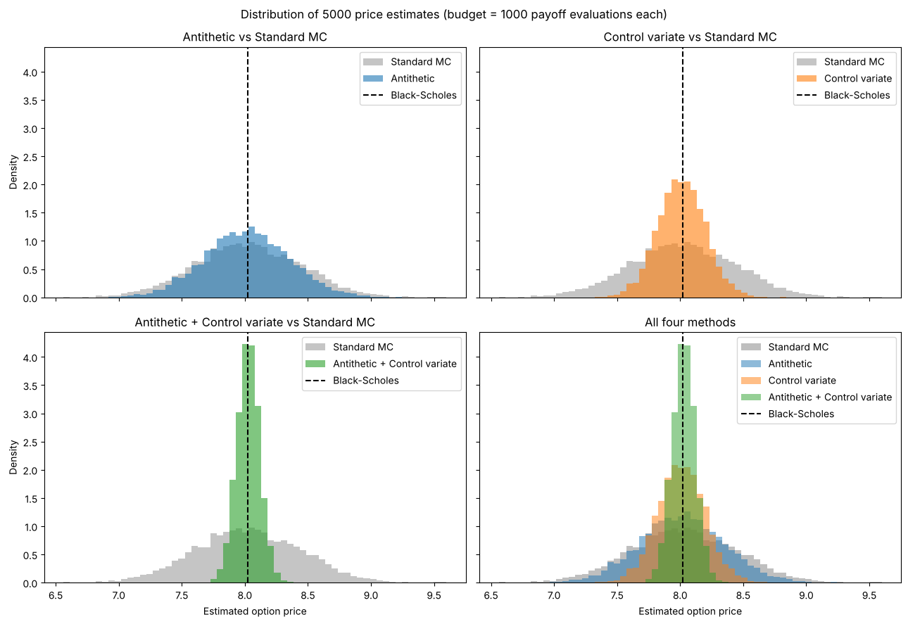
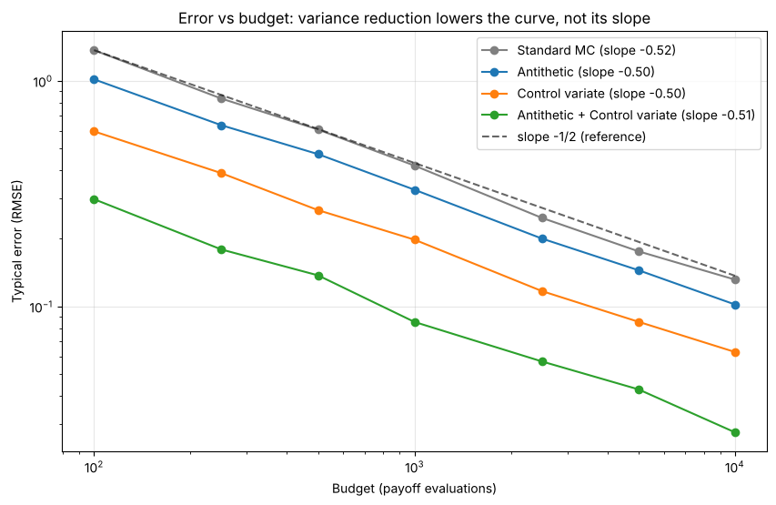

# Monte Carlo pricing of a European call: making the estimate more precise

If we price an option with random simulation, how much more precise can we make the answer **without more computing effort**?

The notebook prices a European call (S0 = 100, strike 105, one year, 5% interest rate, 20% volatility) and compares four estimators that all use the **same budget of 1,000 payoff evaluations**. The exact Black-Scholes price (8.0214) is used only as a yardstick.

## Methods

| Method | Idea |
|---|---|
| Standard Monte Carlo | Average of the discounted payoffs. |
| Antithetic variates | For every random number Z also use −Z. The two payoffs are negatively correlated, so their average is steadier. |
| Control variate | Use the discounted stock price, whose true average (S0) is known, to correct the estimate. |
| Antithetic + control variate | Both techniques together. |

Every estimate comes with a standard error and a 95% confidence interval.

## Results

Each method was repeated 5,000 times with a budget of 1,000 payoff evaluations (seed 42):

| Method | Variance of the estimates | Times smaller than standard | Typical error (RMSE) | 95% CI contains the true price |
|---|---|---|---|---|
| Standard MC | 0.1741 | 1.0× | 0.417 | 95.1% |
| Antithetic | 0.1118 | 1.6× | 0.334 | 94.6% |
| Control variate | 0.0351 | 5.0× | 0.188 | 94.8% |
| Antithetic + control variate | 0.0082 | 21.2× | 0.091 | 93.7% |



All methods keep the same error rate of 1/√budget (slope about −0.5 on a log-log plot). Variance reduction reduces the error by a constant factor, so it lowers the whole error curve without changing its slope.



## What the notebook covers

1. The exact Black-Scholes price.
2. Standard Monte Carlo with a confidence interval.
3. Antithetic variates and the reason they work (correlation of about −0.37).
4. The control variate and the reason it works (correlation of about 0.89).
5. Both techniques together.
6. A repeated experiment: distribution of the estimates, variance, RMSE and how often the 95% interval contains the true price.
7. Convergence as the budget grows.

## How to run

```bash
pip install -r requirements.txt
jupyter notebook Monte_Carlo_Option_Pricing.ipynb
```

The random seed is fixed, so the results above can be reproduced. The notebook is also saved with its outputs, so GitHub shows the tables and plots directly.

## About this project

I wrote the first version of this notebook myself. I then revised and extended it with the help of an AI assistant (Claude), which suggested corrections and additions such as the confidence intervals and the second variance-reduction technique. The structure and explanations were simplified to stay at the level of what I have studied.

## Limitations

- One option and one model (Black-Scholes with constant volatility).
- The confidence interval of the combined method covers slightly less than 95% (93.7% in this run), probably because the correction coefficient is estimated from the same sample.
- Greeks, path-dependent options and other models are not included.
